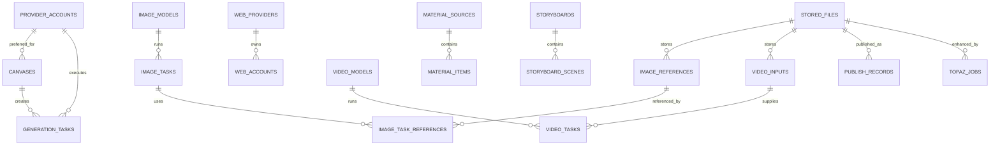

# Lumen Forge 数据库设计

## 目标与约束

- 数据库采用 MySQL 8、InnoDB、`utf8mb4`。外键负责维护核心对象关系，队列和状态查询使用组合索引。
- 程序配置使用 Flyway 版本化迁移；JPA `ddl-auto=validate` 只校验映射，不在启动时静默改表。**已应用的 `V1__initial_schema.sql` 禁止修改**（checksum 会失效）；需要加列时新建 `V2__xxx.sql`。
- 本项目当前是单机本地应用，不建用户/租户表。账号密钥加密后存储；媒体二进制保存在磁盘，数据库只存文件元数据和相对路径。
- 厂商节点 schema、任务参数和结果结构经常变化，画布配置和不可变任务快照用 JSON/LONGTEXT 保存，避免每接入一个模型都迁移关系表。
- 实体字段必须与 DDL 逐列对齐（列类型、可空性），否则启动时 `Schema-validation` 失败。特别注意 DDL 的 `CHAR(n)`、`BIT(1)`、`JSON`、`DATETIME(6)`、`TEXT`、`LONGTEXT` 在实体上都要写 `columnDefinition`。

## 核心关系

## 表职责

| 表 | 用途 | 主要设计点 |
| --- | --- | --- |
| `provider_accounts` | RunningHub API 账号 | 密钥字段只存 AES-GCM 密文；并发、额度、余额和账号统计随账号记录读取 |
| `canvases` | AI 应用/工作流配置 | `account_id` 是可选优先账号；`config_json` 保存动态字段、值、素材引用及扩展选项 |
| `generation_tasks` | RunningHub 任务队列和历史 | 画布/账号可空，支持删除原对象后保留历史；`canvas_config_json` 是提交快照，避免排队时画布修改影响任务 |
| `stored_files` | 本地文件索引 | 保存相对路径、大小、MIME、SHA-256（`char(64)`）；媒体二进制不进数据库 |
| `web_providers`, `web_accounts` | 网页端平台和账号额度池 | 平台配置与账号分开，便于一个平台挂多个登录账号；`stats` 无对应列，不持久化 |
| `image_models` | 图片模型注册表 | `protocol` 取 8 种之一；`config_json` 存放 `akSecret`/`accountId`/尺寸/额外参数等协议专属配置（实体无对应列，故走 JSON） |
| `image_tasks` | 图片生成队列和历史 | `result_json`(LONGTEXT) 存图片数组；`model_id` 可空，删除模型后保留 `model_name` 快照 |
| `image_references` | 参考图库 | `source` 取 `upload`/`generated`/`link`；`remote_url` 用于外链图（无本地文件）；`file_id` 可空 |
| `image_task_references` | 任务与参考图的多对多 | 复合主键 `(image_task_id, reference_id)`，另存 `position_index` 记录提交顺序 |
| `video_models`, `video_inputs`, `video_tasks` | 多厂商视频生成 | 首帧、尾帧作为独立输入记录；任务保存厂商远端任务号（唯一索引） |
| `material_sources`, `material_items` | 外部素材来源和检索缓存 | `(source_id, source_item_id)` 唯一，重复抓取更新已有素材 |
| `topic_history` | 选题池和使用历史 | 对 `used, created_at` 建索引支持筛选未使用选题 |
| `storyboards`, `storyboard_scenes` | 脚本与分镜 | 项目和场景分表；场景生成图/视频复用 `stored_files` |
| `publish_records` | 发布草稿、作品和删除状态 | 保存平台作品 ID 和文件引用，支持按状态回查 |
| `topaz_jobs` | 本地视频增强队列 | 源文件和结果文件均引用 `stored_files` |

## 索引与删除策略

- 任务队列按 `(status, created_at)` 取待派任务，按 `(account_id, status)` 统计账号并发。
- 任务远端 ID 唯一，避免同一平台任务被重复导入；重排队时必须把 `remote_task_id` 置 NULL，否则会撞唯一索引。
- 删除账号/画布时，历史任务的外键设为 `NULL`，但保留任务名、账号名和参数快照。
- 删除模型时，历史任务保留模型名称快照；模型外键设为 `NULL`。
- 删除图片任务时，`image_task_references` 的 task 外键为 `ON DELETE CASCADE`，参考图外键为 `ON DELETE RESTRICT`——即删任务会连带删关联行，但不会误删参考图本身。
- 文件被任务、分镜或发布记录引用时禁止误删；删除文件前由文件服务检查引用（`unlinkIfUnused`：不在根目录内不删、有登记记录不删）。

## 迁移文件

`src/main/resources/db/migration/V1__initial_schema.sql` 创建 MySQL 初始 schema，共 **20 张业务表**。当前 Java 代码已映射其中 **19 张**：

| 已映射（19 张） | 实体 |
| --- | --- |
| `provider_accounts` | `Account` |
| `canvases` | `Canvas` |
| `generation_tasks` | `GenerationTask` |
| `stored_files` | `StoredFile` |
| `web_providers` / `web_accounts` | `WebProvider` / `WebAccount` |
| `image_models` / `image_tasks` / `image_references` / `image_task_references` | `ImageModel` / `ImageTask` / `ImageReference` / `ImageTaskReference`（复合主键走 `@IdClass`） |
| `video_models` / `video_inputs` / `video_tasks` | `VideoModel` / `VideoInput` / `VideoTask` |
| `material_sources` / `material_items` | `MaterialSource` / `MaterialItem` |
| `topic_history` | `TopicHistory` |
| `storyboards` | `Storyboard` |
| `publish_records` | `PublishRecord` |
| `topaz_jobs` | `TopazJob` |

未映射的 1 张：

- `storyboard_scenes`：Python 版未使用该表（分镜场景直接存在 `storyboards` 的 JSON 里），Java 版保持一致，不建实体。

**DDL 中不存在的三张表**：`node_canvases`、`node_canvas_chats`、`node_assets`。Python 侧 `db.py` 对这三张本就是 `id + payload TEXT` 的键值语义，Java 版改用数据目录下的 JSON 快照（`node-canvases.json`、`node-assets.json`），不改 DDL。

实际应用启动时，Flyway 执行迁移，Hibernate 校验实体与表结构。若数据库已有业务表，先备份并检查 `flyway_schema_history`；不要直接删除或重建已有库。

## 存储路径与文件表

`stored_files` 只登记相对路径与元数据，8 类存储目录由 `StoragePaths` 管理（默认都在 `./data` 下）：

| key | 默认子目录 | 说明 |
|---|---|---|
| `uploads` | `uploads` | 画布素材 |
| `outputs` | `outputs` | RunningHub 任务输出 |
| `topaz` | `topaz` | Topaz 增强结果 |
| `generated` | `generated` | 图片生成结果 |
| `refs` | `generated/refs` | 图生图参考图库 |
| `videos` | `videos` | 视频生成结果 |
| `videoInputs` | `video-inputs` | 视频首帧/尾帧 |
| `materials` | `materials` | 素材下载 |

自定义目录写在 `<root>/storage-paths.json`（不落库，保持配置与数据分离）。
